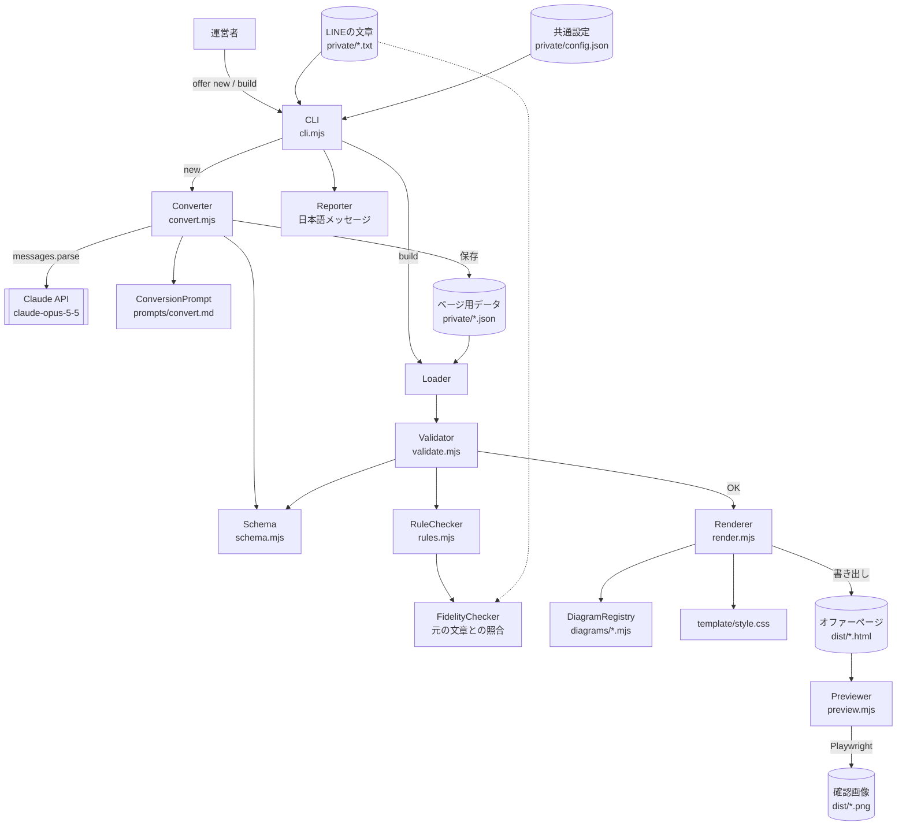

# Design Document

## Overview
LINE のオファー文（テキスト）を Claude API で構造化データ（JSON）に変換し、スキーマ検証と業務ルール検査を経て、図解入りの 1 枚の静的 HTML を生成する Node.js 製の CLI ツールである。処理は「変換（Converter）→ 検証（Validator / RuleChecker）→ 描画（Renderer）→ 確認（Previewer）」の一方向パイプラインで、データ形式の定義（Schema）を全工程で共有する。データベースやサーバーは持たず、入出力はすべてローカルファイルで完結する。

## Architecture
### High-Level Architecture


### System Components
| コンポーネント | ファイル | 概要 |
| --- | --- | --- |
| CLI | `offer-page/cli.mjs` | `new` / `build` サブコマンドの受付、各コンポーネントの呼び出し順の制御 |
| Converter | `offer-page/lib/convert.mjs` | Claude API でオファー文を `OfferContent` に変換する |
| ConversionPrompt | `offer-page/prompts/convert.md` | 自動変換と手作業変換で共有する変換ルール（単一の原本） |
| Schema | `offer-page/lib/schema.mjs` | `OfferContent` の zod スキーマ。検証と API の出力形式指定の両方で使う |
| Validator | `offer-page/lib/validate.mjs` | JSON 構文・スキーマ検証。誤りを日本語の項目名付きで返す |
| RuleChecker | `offer-page/lib/rules.mjs` | 料金・期限・注意書き・禁止表現などの業務ルール検査 |
| FidelityChecker | `offer-page/lib/fidelity.mjs` | 口コミ・金額が元の文章に存在するかの照合 |
| Renderer | `offer-page/lib/render.mjs` | セクションの組み立てと HTML 出力 |
| DiagramRegistry | `offer-page/lib/diagrams/index.mjs` ほか | 図解の種類名 → 描画関数の対応表と各図解の実装 |
| Previewer | `offer-page/lib/preview.mjs` | Playwright でスマホ幅の確認画像を出力 |
| Reporter | `offer-page/lib/report.mjs` | 誤り・警告・完了メッセージを日本語で整形して表示 |
| ConfigLoader | `offer-page/lib/config.mjs` | 共通設定（署名・LINE URL）の読み込みとデータへの補完 |

## Components and Interfaces
### Core Interfaces
```typescript
/** ページ 1 枚分のデータ（private/<名前>.json の中身） */
interface OfferContent {
  page: PageMeta;
  hero: Hero;
  letter: string[];                 // 冒頭のあいさつ（段落の配列）
  reading: Reading;                 // 鑑定で視えたこと
  message?: string[];               // 運営者からの想い（引用ブロック）
  overview: Overview;               // 3 ステップ図
  menusHeading?: string;
  menus: Menu[];                    // 1〜6 件
  testimonials?: Testimonials;
  pricing: Pricing;
  luckyDay?: LuckyDay;
  future: Future;
  apply: Apply;
  signature: string;                // 署名（未指定時は config から補完）
  disclaimer: string[];             // 必須・1 件以上
}

/** 文章中の記法: **強調** はマーカー表示、\n は改行 */
type RichText = string;

interface PageMeta {
  title: string;                    // <title>
  customerName: string;             // 例: "福嶋"
  honorific?: string;               // 既定 "さん"
  deadline?: string;                // 表示用の期限。例: "10月20日"
}

interface Hero { label: string; title: RichText; lead: RichText; }

interface Reading {
  kicker?: string;
  heading: string;
  intro?: RichText[];
  now: { label: string; items: RichText[] };
  wall: { label: string; text: RichText };
  wish: { label: string; items: RichText[] };
  after?: RichText[];
}

interface Overview {
  kicker?: string;
  heading: string;
  intro?: RichText[];
  steps: { menu: number; time: string; verb: string; what: RichText }[];   // menu は Menu.no を参照
  after?: RichText[];
}

type MenuColor = "sage" | "lavender" | "gold" | "rose";

interface Menu {
  no: number;                       // 1 始まり。①②③ の表示に使う
  name: string;
  short: string;                    // 表やバッジ用の短い名前
  badge?: string;                   // 例: "非公開サービス"
  color?: MenuColor;                // 未指定時は順番で自動割当
  normalPrice: number;              // 円（整数）
  price: number;                    // 特別価格（円）
  catch: RichText;
  intro?: RichText[];
  innerVoices?: string[];           // お客様の心の声（吹き出し）
  body?: RichText[];
  diagram?: Diagram;
  goalTitle?: string;
  goal?: RichText[];
}

type Diagram = BeforeAfterDiagram | BalanceDiagram | RadiateDiagram;

interface BeforeAfterDiagram {
  type: "beforeAfter";
  arrow?: string;
  before: { title: string; items: RichText[] };
  after: { title: string; items: RichText[] };
}

interface BalanceDiagram {
  type: "balance";
  left: string;                     // 重く傾いている側（8 文字以内推奨）
  right: string;
  heavy?: string;                   // 重りに書く言葉（6 文字以内推奨）
  beforeTitle: string;
  beforeNote: RichText;
  afterTitle: string;
  afterNote: RichText;
}

type IconName = "sun" | "calendar" | "family" | "heart" | "leaf" | "wave" | "sparkle"
  | "coin" | "briefcase" | "home" | "cloud" | "check" | "line";

interface RadiateDiagram {
  type: "radiate";
  centerLabel?: string;
  center: RichText;
  branches: { icon: IconName; label: string; text: RichText }[];   // 2〜4 件
}

interface Testimonials {
  heading: string;
  items: string[];
  link?: { label: string; url: string };
}

interface Pricing {
  heading: string;
  intro?: RichText[];
  set?: {                           // セット販売がない場合は省略
    label: string;
    short?: string;
    note?: string;
    normalTotal: number;
    price: number;
  };
  after?: RichText[];
  schedule?: { label: string; text: RichText }[];
}

interface LuckyDay {
  date: string;
  badges: { name: string; text: string }[];
  note: RichText;
}

interface Future {
  kicker?: string;
  heading: string;
  intro?: RichText[];
  scenes: { icon: IconName; when: string; text: RichText }[];        // 2〜6 件
  motto?: RichText;
  after?: RichText[];
}

interface Apply {
  heading: string;
  steps: RichText[];
  button?: { label: string; url: string };   // url が空ならボタン非表示
  notes?: RichText[];
}

/** 検証結果 */
type Severity = "error" | "warning";

interface Issue {
  severity: Severity;
  path: (string | number)[];        // 例: ["menus", 1, "price"]
  label: string;                    // 日本語の場所。例: "施術②の特別価格"
  message: string;                  // 日本語の説明と直し方
  code: string;                     // 例: "PRICE_ABOVE_NORMAL"
}

interface ValidationResult {
  content: OfferContent | null;     // error が 0 件のときのみ値が入る
  issues: Issue[];
}

/** 共通設定（private/config.json） */
interface OfferConfig {
  signature?: string;
  lineUrl?: string;
  lineButtonLabel?: string;
}
```

### CLI
**Responsibilities:**
- 引数を解釈し、`new`（文章 → データ → ページ）と `build`（データ → ページ）を実行する。
- 出力先の存在確認と、上書き時の `--force` 判定を行う。
- 各工程の結果を Reporter に渡し、終了コード（成功 0 / 誤りあり 1 / 想定外の失敗 2）を返す。

**Key Methods:**
- `main(argv: string[]): Promise<number>`
- `runNew(name: string, sourcePath: string, opts: { force: boolean; preview: boolean }): Promise<number>`
- `runBuild(jsonPath: string, opts: { out?: string; preview: boolean; source?: string }): Promise<number>`

### Converter
**Responsibilities:**
- `prompts/convert.md` から変換ルール部分を読み込み、システムプロンプトとして使う。
- Claude API を呼び出し、Schema に沿った `OfferContent` を受け取る。
- API キー未設定・拒否（refusal）・出力の解析失敗を、それぞれ区別できるエラーとして返す。
- テスト用に、API クライアントを外から差し替えられるようにする。

**Key Methods:**
- `convertOffer(sourceText: string, opts?: { client?: Anthropic }): Promise<OfferContent>`
- `loadConversionRules(): string`

### Schema
**Responsibilities:**
- `OfferContent` を zod で定義する唯一の場所。
- 各項目に日本語の表示名（`describe`）を持たせ、Validator のメッセージに使う。
- Converter には `zodOutputFormat` 経由で出力形式として渡す。

**Key Methods:**
- `OfferContentSchema: z.ZodType<OfferContent>`
- `fieldLabel(path: (string | number)[]): string`

### Validator
**Responsibilities:**
- JSON の構文エラーを行番号付きで検出する。
- Schema による型・必須項目の検証を行い、すべての誤りを `Issue[]` に変換する。
- RuleChecker と FidelityChecker を呼び出し、結果をまとめる。

**Key Methods:**
- `parseJsonFile(path: string): { data: unknown } | { issue: Issue }`
- `validateContent(data: unknown, opts?: { sourceText?: string }): ValidationResult`

### RuleChecker
**Responsibilities:**
- 料金ルール（特別価格 ≤ 通常価格、セット合計の一致、セット価格の妥当性）の検査。
- 期限の有無、注意書きの有無、`overview.steps[].menu` が存在する施術を指しているかの検査。
- 禁止表現（不安をあおる表現・効果の断定）の検出。禁止表現は `offer-page/lib/phrases.mjs` で一覧管理する。

**Key Methods:**
- `checkRules(content: OfferContent): Issue[]`
- `findRiskyPhrases(content: OfferContent): Issue[]`

### FidelityChecker
**Responsibilities:**
- 自動変換時のみ、口コミの文言と全金額が元の文章に存在するかを照合する。
- 照合は空白・全角半角・カンマの違いを正規化してから行う。

**Key Methods:**
- `checkFidelity(content: OfferContent, sourceText: string): Issue[]`
- `normalize(text: string): string`

### Renderer
**Responsibilities:**
- `OfferContent` からセクション単位の HTML を組み立て、`template/style.css` を埋め込んだ 1 枚の HTML を返す。
- すべての文字列をエスケープし、`**強調**` と改行だけを HTML に変換する。
- 施術の色（未指定時）を順番で割り当てる。

**Key Methods:**
- `renderPage(content: OfferContent): string`
- `rich(text: RichText): string` / `esc(text: string): string`
- `renderMenu(menu: Menu): string` などセクションごとの関数

### DiagramRegistry
**Responsibilities:**
- 図解の種類名と描画関数の対応表を持つ。新しい図解はファイルを追加して対応表に登録するだけで使える。
- 共通図解（鑑定・3 ステップ・料金・タイムライン）と施術用図解（beforeAfter / balance / radiate）を実装する。

**Key Methods:**
- `MENU_DIAGRAMS: Record<Diagram["type"], (d: Diagram) => string>`
- `renderReading(r: Reading): string`
- `renderSteps(o: Overview, menus: Menu[]): string`
- `renderPrice(menus: Menu[], set: Pricing["set"]): string`
- `renderTimeline(f: Future): string`

### Previewer
**Responsibilities:**
- 生成した HTML を Chromium（Playwright）で幅 390px で開き、全体の PNG を保存する。
- 横スクロール幅（`scrollWidth`）を測り、画面幅を超えていれば警告を返す。
- Playwright が使えない環境では例外を投げず、理由を返す。

**Key Methods:**
- `capturePreview(htmlPath: string, opts?: { width?: number }): Promise<{ pngPath?: string; overflow: boolean; error?: string }>`

### Reporter
**Responsibilities:**
- `Issue[]` を「誤り」「警告」に分け、場所と直し方を日本語で表示する。
- 完了時に、作成したファイルのパスを一覧表示する。

**Key Methods:**
- `printIssues(issues: Issue[]): void`
- `printDone(files: { label: string; path: string }[]): void`

### ConfigLoader
**Responsibilities:**
- `private/config.json` があれば読み込み、`signature` と `apply.button` の未指定項目を補完する。
- 設定ファイルがなくてもエラーにしない。

**Key Methods:**
- `loadConfig(dir: string): OfferConfig`
- `applyDefaults(content: OfferContent, config: OfferConfig): OfferContent`

## Data Models
### Database Schema
本システムはデータベースを使用しない。お客様 1 人につき JSON ファイル 1 つで完結し、検索・集計・同時編集の要件がないため、ファイルの方が運営者にとって扱いやすく、個人情報を Git 管理対象外に置く運用とも整合する。

将来、成約率の検証（Requirement の対象外）のためにページの送付・成約を記録する場合は、以下のテーブルを想定する。
```sql
-- 参考: 現時点では実装しない
CREATE TABLE offer_pages (
  id            UUID PRIMARY KEY,
  customer_name TEXT        NOT NULL,
  content       JSONB       NOT NULL,          -- OfferContent
  deadline      DATE,
  sent_at       TIMESTAMPTZ,
  converted_at  TIMESTAMPTZ,                   -- 申込があった日時
  menus_ordered INTEGER[]                      -- 申し込まれた施術番号
);
```

### File Storage Structure
```
/ (リポジトリ)
├── CLAUDE.md, requirements.md, design.md, task.md
├── package.json                 # scripts: offer, test / 依存バージョン固定
├── .gitignore                   # offer-page/private/, offer-page/dist/
└── offer-page/
    ├── cli.mjs                  # 入口
    ├── build.mjs                # 互換用: cli.mjs build を呼ぶだけ
    ├── lib/
    │   ├── schema.mjs
    │   ├── validate.mjs
    │   ├── rules.mjs
    │   ├── phrases.mjs          # 禁止表現リスト
    │   ├── fidelity.mjs
    │   ├── convert.mjs
    │   ├── config.mjs
    │   ├── render.mjs
    │   ├── html.mjs             # esc / rich / icon
    │   ├── report.mjs
    │   ├── preview.mjs
    │   └── diagrams/
    │       ├── index.mjs        # 対応表
    │       ├── reading.mjs, steps.mjs, price.mjs, timeline.mjs
    │       └── before-after.mjs, balance.mjs, radiate.mjs
    ├── template/style.css
    ├── prompts/convert.md       # 変換ルールの原本（自動・手作業で共有）
    ├── examples/sample.json     # 匿名化した見本
    ├── test/                    # node:test
    ├── private/                 # Git 管理外: <名前>.txt, <名前>.json, config.json, <名前>.raw.txt
    └── dist/                    # Git 管理外: <名前>.html, <名前>.png
```

## Configuration
共通設定は任意で `offer-page/private/config.json` に置く（Git 管理外）。
```json
{
  "signature": "コヤ",
  "lineUrl": "https://line.me/R/ti/p/@xxxxxxx",
  "lineButtonLabel": "LINEで返信する"
}
```
環境変数:
| 変数 | 用途 |
| --- | --- |
| `ANTHROPIC_API_KEY` | Claude API の認証（`new` コマンドのみ必要） |
| `OFFER_MODEL` | 変換に使うモデルの上書き（既定 `claude-opus-5-5`） |

## External API Integration
- **API**: Claude API（Messages API）
- **ライブラリ**: `@anthropic-ai/sdk`（公式 TypeScript/JavaScript SDK）、`zod`（スキーマ定義）
- **モデル**: `claude-opus-5-5`（`OFFER_MODEL` で変更可）
- **呼び出し方**: `client.messages.parse()` に `output_config: { format: zodOutputFormat(OfferContentSchema), effort: "medium" }` を指定し、`parsed_output` を受け取る。思考は adaptive（既定）のまま。`max_tokens` は 16000。
- **プロンプト構成**: system = `prompts/convert.md` の変換ルール部分（毎回同一のため、プロンプトキャッシュの対象にする）／ user = オファー文。
- **認証**: SDK 既定の解決順（`ANTHROPIC_API_KEY` など）。キーはログに出さない。
- **拒否時のフォールバック**: SDK のリクエストに `fallbacks: "default"`（ベータ `server-side-fallback-2026-07-01`）を付け、安全分類で拒否された場合はサーバー側で別モデルに回す。それでも `stop_reason === "refusal"` の場合は手作業変換を案内する。
- **エラーハンドリング戦略**:
  - 429 / 5xx / 接続エラー: SDK の自動再試行（`maxRetries: 3`、指数バックオフ）。使い切った場合は「時間をおいて再実行」を案内。
  - 401 / 403: API キーの確認を案内（再試行しない）。
  - 400: リクエスト内容の不備として、元のメッセージを表示（再試行しない）。
  - `stop_reason === "max_tokens"`: 文章が長すぎる旨を案内。
  - `parsed_output === null`: 生の出力を `private/<名前>.raw.txt` に保存し、手で直して `build` する方法を案内。
  - サーキットブレーカーは、1 回の実行で 1 リクエストのみのため不要と判断する。
- エラー分岐は SDK の型付き例外（`Anthropic.AuthenticationError`, `Anthropic.RateLimitError`, `Anthropic.APIError` 等）で行い、メッセージ文字列の照合はしない。

## Error Handling
| 種類 | 例 | 対応 |
| --- | --- | --- |
| 入力ファイルの誤り | 文章ファイルが存在しない・空 | 処理を止め、パスと原因を表示（終了コード 1） |
| JSON 構文エラー | カンマ抜け | 行番号と前後の行を表示（終了コード 1） |
| スキーマ違反 | 金額が文字列、必須項目なし | 全件を「場所＋直し方」で表示し、ページは作らない（終了コード 1） |
| 業務ルール違反（error） | 注意書きなし、特別価格 > 通常価格 | 同上 |
| 業務ルール違反（warning） | 期限なし、禁止表現、元の文章にない口コミ | ページは作成し、最後に警告をまとめて表示（終了コード 0） |
| API エラー | 上記「External API Integration」参照 | 種類に応じた案内（終了コード 1） |
| 上書き | 同名のデータが既にある | `--force` がなければ中止して案内（終了コード 1） |
| 確認画像の失敗 | Playwright 未導入 | ページは成功扱い、理由を警告表示 |
| 想定外の例外 | バグ | スタックトレースを表示（終了コード 2） |

## Testing Strategy
テストランナーは Node.js 標準の `node:test` を使い、`npm test` で全件実行する（追加ライブラリ不要）。
- **単体テスト**
  - `html.mjs`: エスケープ（`<script>` が無害化される）、`**強調**`・改行の変換。
  - `schema.mjs` / `validate.mjs`: 正常な見本が通る、必須項目欠落・型違い・図解種類の誤りがそれぞれ日本語の場所付きで返る、複数の誤りが全件返る、JSON 構文エラーの行番号。
  - `rules.mjs`: 料金・期限・注意書き・`overview.steps` の参照・禁止表現の各ルールについて、違反あり／なしの両ケース。
  - `fidelity.mjs`: 正規化（全角数字・カンマ・空白）、元の文章にない口コミ・金額の検出。
  - `diagrams/*`: 各図解が必要な文字列を含む HTML を返す、天秤の傾き座標、料金グラフの幅計算。
  - `config.mjs`: 設定ファイルの有無、補完の優先順位（データ側の値が優先）。
  - `convert.mjs`: 差し替えたクライアントで、正常・拒否・解析失敗・認証エラーの分岐。
- **結合テスト**
  - `examples/sample.json` → `renderPage` の HTML に、全セクションの見出し・全金額・注意書き（2 か所）・`noindex` が含まれる。
  - CLI `build`: 一時フォルダで実行し、HTML が書き出され終了コード 0。誤りのあるデータでは HTML が作られず終了コード 1。
  - CLI `new`: 差し替えたクライアントで、データ → HTML まで作られる。同名ファイルがあるときに `--force` なしで中止される。
- **表示テスト（ブラウザ）**
  - Playwright で見本ページを幅 360 / 390 / 430px で開き、`scrollWidth` が画面幅以下であること、本文の `font-size` が 17px 以上であることを確認する。Chromium がない環境ではスキップする。
- **パフォーマンステスト**
  - 施術 6 件・口コミ 20 件の大きめのデータで `renderPage` が 200ms 以内に終わることを確認する（負荷試験はサーバーを持たないため対象外）。
